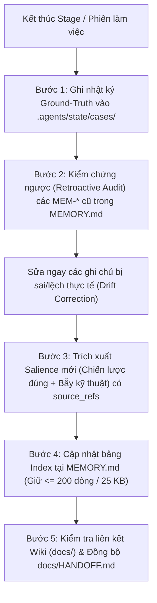

# KỸ NĂNG: TỔNG HỢP & NUÔI DƯỠNG BỘ NHỚ 4 TẦNG (MEMORY-CONSOLIDATION)

Kỹ năng vận hành cơ chế **Dreaming & Memory Consolidation** dựa trên nghiên cứu thực nghiệm của Anthropic ([*The components of agent memory*, 06/11/2026](https://www.anthropic.com/research/components-of-agent-memory)) và kiến trúc [Claude Code Memory](https://code.claude.com/docs/en/memory).

---

## 1. KIẾN TRÚC 4 TẦNG BỘ NHỚ CHUẨN ANTHROPIC

1. **Layer 1 — Transcripts & Event Logs (`.agents/state/cases/session_<TIMESTAMP>.md`)**:
   - Nhật ký sự kiện thô ghi lại các lệnh đã chạy, Evidence IDs thu được, các lỗi phát sinh và quyết định của người dùng trong phiên. Đóng vai trò là **Ground-Truth** để kiểm chứng ngược.
2. **Layer 2 — Memory Notes (`.agents/state/MEMORY.md` & `.agents/state/learned_rules.json`)**:
   - Lưu trữ các quan sát nổi bật (*salient observations*): bao gồm **cả chiến lược thành công, cấu hình công cụ đã kiểm chứng, quyết định kiến trúc và cảnh báo bẫy kỹ thuật (traps)**.
   - *Nguyên tắc Salience của Anthropic*: Không giới hạn chỉ ghi lại lỗi (*never restrict to record-only-failures*), vì thực nghiệm CL-Bench chỉ ra quy tắc chỉ ghi lỗi làm giảm mạnh hiệu năng suy luận của Agent.
3. **Layer 3 — Memory Representations / Wiki (`docs/`)**:
   - Bản đồ tri thức liên kết chéo gồm `docs/WORKFLOW_LIFECYCLE.md`, `docs/ARCHITECTURE.md`, `docs/SOURCE_AUDIT.md`, và `docs/adrs/0001..0006`.
4. **Layer 4 — Injected Context (`AGENTS.md`, `active_case.json`, `docs/HANDOFF.md`, và `MEMORY.md` Index)**:
   - Ngữ cảnh được nạp tự động vào đầu mỗi phiên làm việc mới (qua `prompts/00-SESSION-CONTINUITY.md`).
   - **Giới hạn cứng (Hard Cap)**: File `.agents/state/MEMORY.md` bắt buộc giữ gọn **dưới 200 dòng hoặc 25 KB** để đóng vai trò bảng chỉ mục (Index) không làm loãng sự chú ý của mô hình.

---

## 2. QUY TRÌNH DREAMING 5 BƯỚC (CÓ KIỂM CHỨNG NGƯỢC)

### Bước 1: Ghi Nhật Ký Sự Kiện Phiên (Layer 1 Ground-Truth)
- Dùng công cụ ghi file chuẩn của Agent để tạo `.agents/state/cases/session_<YYYYMMDD_HHmmss>.md` tóm tắt: Stage/Step vừa chạy, danh sách Evidence IDs / kết quả `verify_code.ps1`, và các thay đổi trong `git status` / `git diff --stat` (không phụ thuộc plugin ngoài).

### Bước 2: Kiểm Chứng Ngược Ghi Chú Cũ (Retroactive Drift Correction)
- Đọc toàn bộ các dòng `MEM-XXX` đang có trong `.agents/state/MEMORY.md` và đối chiếu với nhật ký thực tế ở Bước 1 cùng các file trong `source_refs`.
- Nếu phát hiện bất kỳ `MEM-XXX` nào chứa thông tin sai lệch hoặc đã lỗi thời khi môi trường thay đổi, **bắt buộc sửa lại nội dung hoặc đánh dấu `DEPRECATED`** để ngăn lỗi lan truyền sang các phiên sau.

### Bước 3: Trích Xuất Tri Thức Nổi Bật Mới (Provenance-Backed Salience)
- Chọn lọc các quy tắc kỹ thuật, thông số cấu hình REA/Android CLI hiệu quả, hoặc bài học khắc phục sự cố có chứng cứ rõ ràng (`source_refs` trỏ tới file thực tế trong repo). Không lưu suy đoán chưa kiểm chứng.

### Bước 4: Cập Nhật `.agents/state/MEMORY.md` & `.agents/state/learned_rules.json`
- Thêm hoặc cập nhật dòng trong bảng Markdown tại `.agents/state/MEMORY.md` theo đúng các cột: `ID | Scope | Loại | Khẳng định cốt lõi & Cảnh báo bẫy | Nguồn chứng cứ (source_refs) | Xác minh`.
- Kiểm tra tổng số dòng của `.agents/state/MEMORY.md` phải `<= 200 dòng`. Nếu vượt quá, hợp nhất các mục cùng `Scope` hoặc chuyển chi tiết sang `.agents/state/cases/` và chỉ giữ dòng tóm tắt kèm link trong `MEMORY.md`.

### Bước 5: Vá Liên Kết Wiki (Layer 3) & Đồng Bộ Bàn Giao (Layer 4)
- Kiểm tra mọi đường dẫn tương đối trong `MEMORY.md` và `docs/` đều trỏ tới file tồn tại thực tế.
- Cập nhật trạng thái mới nhất vào `docs/HANDOFF.md` và `docs/PROGRESS.md`.
