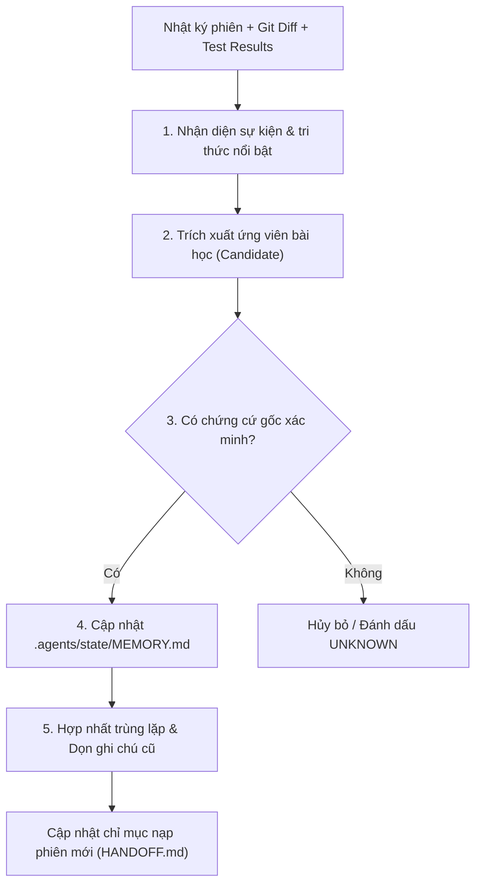

# KỸ NĂNG: TỔNG HỢP & NUÔI DƯỠNG BỘ NHỚ ĐA PHIÊN (MEMORY-CONSOLIDATION)

Kỹ năng vận hành cơ chế **Dreaming & Memory Consolidation** giúp REA-kit-agy tự tích lũy kinh nghiệm, không quên ngữ cảnh và không bị phình dữ liệu rác qua nhiều phiên làm việc.

---

## 1. NGUYÊN TẮC CỐT LÕI (ANTHROPIC AGENT MEMORY STANDARD)

1. **Phân biệt 4 tầng bộ nhớ độc lập**:
   - **Tầng 1 (Transcripts / Event Logs)**: Nhật ký gốc những gì Agent thực sự đã làm (lưu tại `.agents/state/cases/`).
   - **Tầng 2 (Memory Notes)**: Ghi chú bền vững, bài học kỹ thuật, quy tắc đã kiểm chứng (lưu tại `.agents/state/MEMORY.md` và `learned_rules.json`).
   - **Tầng 3 (Memory Representations)**: Bản đồ tri thức, kiến trúc, liên kết wiki giữa các tài liệu (lưu tại `docs/`).
   - **Tầng 4 (Injected Context)**: Ngữ cảnh nạp đầu mỗi phiên làm việc mới (`active_case.json`, `AGENTS.md`, `docs/HANDOFF.md`).
2. **Quy tắc Kiểm chứng Nguồn gốc (Provenance Rule)**:
   - Mọi tri thức bền vững đưa vào Tầng 2 bắt buộc phải truy ngược được về commit mã nguồn, kết quả test, hoặc báo cáo bằng chứng cụ thể.
   - Tuyệt đối không lưu lại các nhận định suy đoán chưa được kiểm chứng.
3. **Quy tắc Đơn Quyền Ghi (Single Writer Rule)**:
   - Duy nhất Control Agent (hoặc tác vụ Consolidation do người dùng kích hoạt) được ghi vào `MEMORY.md`.
   - Ngăn chặn hoàn toàn hiện tượng đa agent cùng ghi đè làm mất mát tri thức.

---

## 2. QUY TRÌNH CONSOLIDATION 5 BƯỚC ("DREAMING PROTOCOL")

Kỹ năng được kích hoạt vào cuối mỗi Milestone lớn hoặc khi kết thúc một phiên làm việc:



### Bước 1: Rà soát Sự kiện Phiên
- Đọc git log, các file sửa đổi và kết quả chạy test tại `03_KET_QUA_KIEM_TRA/`.
- Nhận diện các lỗi đã sửa thành công (verified fixes), rào cản môi trường đã khắc phục (workarounds), hoặc quyết định người dùng đã chốt.

### Bước 2: Trích xuất Ứng viên Tri thức
- Chọn lọc các tri thức có giá trị tái sử dụng cho các phiên tiếp theo:
  * Ranh giới tương thích thư viện / công cụ REA.
  * Lỗi cú pháp hay gặp và mẫu regex/parser phát hiện.
  * Quy tắc giao diện hoặc hành vi đặc thù của target app.

### Bước 3: Đối chiếu Bằng chứng Gốc (Provenance Check)
- Truy ngược nguồn gốc: File nào bị lỗi? Commit nào đã sửa? Lệnh nào đã kiểm chứng?
- Nếu không tìm thấy chứng cứ rõ ràng, loại bỏ ngay lập tức để tránh ảo giác tích lũy.

### Bước 4: Cập nhật `.agents/state/MEMORY.md`
- Ghi nhận vào file theo cấu trúc chuẩn:
```json
{
  "memory_id": "MEM-XXX",
  "scope": "PHẠM_VI (ví dụ: TARGET_ROUTING, BUILD_SAFETY)",
  "type": "LOẠI (TECHNICAL_RULE, ARCHITECTURAL_DECISION, VERIFIED_FIX)",
  "claim": "Nội dung khẳng định ngắn gọn dưới 20 từ.",
  "status": "VERIFIED",
  "source_refs": ["đường_dẫn_tệp_chứng_cứ"],
  "created_at": "YYYY-MM-DD",
  "last_verified": "YYYY-MM-DD",
  "review_required": false
}
```

### Bước 5: Hợp nhất & Tinh Gọn Ngữ Cảnh
- Gộp các ghi chú có nội dung tương tự.
- Đánh dấu `DEPRECATED` hoặc xóa bỏ các ghi chú đã bị thay thế bởi kiến trúc mới.
- Cập nhật tóm tắt vào `docs/HANDOFF.md` để phiên sau nạp vào ngữ cảnh gọn gàng nhất.
