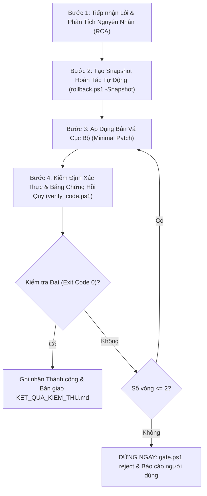

# KỸ NĂNG: VÁ LỖI CỤC BỘ & KIỂM SOÁT HỒI QUY (SURGICAL-PATCH)

Kỹ năng chuyên biệt dành cho các tác vụ khắc phục lỗi có mục tiêu (Targeted Bug Fixes), vòng lặp khắc phục từ chối cổng (Reject Loops từ Cổng 04 hoặc Cổng 05), và quy trình yêu cầu thay đổi vi mô (Micro Change Requests).

---

## 1. BA NGUYÊN TẮC BẤT DI BẤT DỊCH (IMMUTABLE PRINCIPLES)

1. **Nguyên Tắc Lớp Trách Nhiệm Hẹp Nhất (Narrowest Responsible Layer Principle)**:
   - Chỉ chỉnh sửa đúng tệp, đúng hàm, đúng dòng mã phát sinh lỗi.
   - **CẤM TUYỆT ĐỐI**:
     * Viết lại toàn bộ tệp (Rewrite from scratch).
     * Tự ý tái cấu trúc (Refactoring) các module xung quanh đang hoạt động ổn định.
     * Thay đổi cấu trúc dữ liệu nền tảng hoặc kiến trúc đã được đóng băng tại Cổng 03.
   - Bảng phân cấp lớp sửa lỗi:
     * Lỗi Token / Màu sắc / Spacing ➔ **CHỈ sửa** file tokens hoặc biến CSS (`var(--...)`) / Compose tokens.
     * Lỗi Logic xử lý dữ liệu ➔ **CHỈ sửa** hàm xử lý sự kiện hoặc transformer liên quan.
     * Lỗi Giao diện / Bố cục ➔ **CHỈ sửa** thuộc tính CSS hoặc thuộc tính layout Android cụ thể.
     * Lỗi Cú pháp / Build ➔ **CHỈ sửa** đúng đoạn mã vi phạm kiểm tra cú pháp AST.

2. **Bảo Toàn Bản Sao Lưu & Hoàn Tác Tức Thì (Snapshot & Rollback Guarantee)**:
   - Mọi thao tác sửa mã đều **bắt buộc** phải tạo snapshot trước khi chỉnh sửa tệp đầu tiên:
     ```powershell
     powershell -NoProfile -ExecutionPolicy Bypass -File .\.agents\scripts\rollback.ps1 -Snapshot
     ```
   - Đảm bảo người dùng có thể nhấp đúp vào `HOAN_TAC.bat` bất cứ lúc nào để quay về trạng thái an toàn trước đó.

3. **Cung Cấp Bằng Chứng Hồi Quy (Regression Proof Mandatory)**:
   - Bản vá chỉ được coi là hoàn tất khi có bằng chứng chứng minh:
     * (a) Lỗi mục tiêu (Targeted Bug) đã được triệt tiêu 100%.
     * (b) Các chức năng, kịch bản Golden Scenarios đã đạt trước đó không bị ảnh hưởng (No Regression).
   - Bắt buộc chạy lại script kiểm tra xác định `verify_code.ps1` và bộ test liên quan.

4. **Khống Chế Vòng Lặp Tự Sửa Tối Đa 2 Vòng (Max 2 Rounds Convergence Limit)**:
   - Giới hạn cứng số lần tự sửa lỗi: `review_convergence_rounds <= 2`.
   - Mỗi lần chạy `verify_code.ps1` thất bại, tăng biến đếm `metrics.review_convergence_rounds += 1` trong `.agents/state/active_case.json`.
   - **ĐIỀU KIỆN DỪNG CỨNG**: Nếu sau 2 vòng tự sửa mà bài kiểm tra vẫn thất bại:
     * **DỪNG LẠI NGAY LẬP TỨC**. Không được tiếp tục thử vận may vòng thứ 3!
     * Chạy lệnh từ chối cổng:
       ```powershell
       powershell -NoProfile -ExecutionPolicy Bypass -File .\.agents\scripts\gate.ps1 reject 4 -Reason "Hội tụ thất bại sau 2 vòng tự sửa lỗi (Max convergence limit reached)."
       ```
     * Xuất báo cáo phân tích nguyên nhân gốc rễ (RCA) vào `03_KET_QUA_KIEM_TRA/RCA_CONVERGENCE_FAILURE.md` và xin ý kiến chỉ đạo từ người dùng / Coordinator.

---

## 2. QUY TRÌNH THỰC THI 4 BƯỚC VÁ LỖI (SURGICAL FIX PROTOCOL)



### Bước 1: Tiếp nhận Lỗi & Cô lập Phạm vi (RCA & Scope Isolation)
1. Đọc báo cáo lỗi từ `03_KET_QUA_KIEM_TRA/KET_QUA_KIEM_THU.md` hoặc log đầu ra của `verify_code.ps1` / `rea-verify`.
2. Trích xuất chính xác:
   - Tệp mục tiêu cần sửa (Target File).
   - Vị trí dòng / hàm gây lỗi (Line / Function scope).
   - Tiêu chí chấp nhận sửa lỗi (Success Criteria).
3. Xác định lớp trách nhiệm hẹp nhất theo Bảng phân cấp lớp sửa lỗi.

### Bước 2: Tạo Snapshot Hoàn tác Tự động
1. Chạy lệnh tạo bản sao lưu snapshot:
   ```powershell
   powershell -NoProfile -ExecutionPolicy Bypass -File .\.agents\scripts\rollback.ps1 -Snapshot
   ```
2. Xác nhận bản snapshot mới đã được ghi nhận trong `05_MA_NGUON_PHAT_TRIEN/.backup/`.

### Bước 3: Áp Bản Vá Tối Thiểu (Minimal Surgical Edit)
1. Sử dụng công cụ chỉnh sửa tệp chính xác (`edit_file`) thay vì ghi đè toàn bộ tệp (`write_file` nguyên file).
2. Chỉ thay thế đúng chuỗi ký tự hoặc khối mã cần sửa.
3. Bảo toàn nguyên vẹn định dạng, comment hướng dẫn và các hàm xung quanh.

### Bước 4: Kiểm Định Lại & Cung Cấp Bằng Chứng Hồi Quy
1. Chạy lại kiểm tra xác định:
   ```powershell
   powershell -NoProfile -ExecutionPolicy Bypass -File .\.agents\scripts\verify_code.ps1
   ```
2. Nếu dự án có test suite E2E hoặc Golden Scenarios: Kích hoạt `rea-verify` để chạy kiểm tra hồi quy các luồng chính.
3. Đánh giá kết quả:
   - Nếu `Exit Code 0`: Cập nhật `03_KET_QUA_KIEM_TRA/KET_QUA_KIEM_THU.md` với mục `BẰNG CHỨNG KHẮC PHỤC HỒI QUY (REGRESSION PROOF)`.
   - Nếu `Exit Code 1`: Tăng biến đếm vòng lặp và đối chiếu với giới hạn tối đa 2 vòng.
