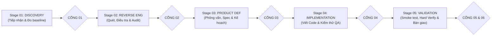

# HƯỚNG DẪN SỬ DỤNG NHANH — REA-KIT-AGY
*(Dành cho người dùng phổ thông — Không cần biết lập trình)*

---

## ⚡ MÔI TRƯỜNG THỰC THI BẮT BUỘC (REQUIRED AGENT RUNTIME)

Bộ kit `REA-kit-agy` được thiết kế để vận hành tự động trong môi trường **Local AI Agent**:
- **Nền tảng khuyến nghị**: **Google Antigravity** hoặc các IDE Coding Agent cục bộ (Antigravity IDE, Claude Code, Cursor, OpenCode).
- **Yêu cầu môi trường thiết yếu**:
  1. **Quyền truy cập Terminal**: Có thể thực thi PowerShell 5.1+/pwsh trên Windows, hoặc Bash trên Linux/macOS để chạy các lá chắn tự động (`health_check`, `verify_code`, `rollback`, `gate`).
  2. **Hỗ trợ giao thức MCP (Model Context Protocol)**: Để kết nối trực tiếp với công cụ phân tích dịch ngược `reverse-engineer-anything` (REA MCP) và các Host Plugins như `android-cli`.
- ⚠️ *Lưu ý*: Không thể sử dụng trên các giao diện web chat thông thường (như ChatGPT Web, Claude Web) vì các công cụ này không có quyền đọc/ghi file ổ đĩa và không có terminal cục bộ.

---

## 🔄 LỰA CHỌN CHẾ ĐỘ: 5 TABS HAY QUICK-PROMPTS? (DUAL-MODE UX)

| Tiêu Chí | Quy Trình 5 Tabs Chính Thức (`prompts/01` → `05`) | Sổ Tay Lệnh Nhanh (`prompts/QUICK-PROMPTS.md`) |
| :--- | :--- | :--- |
| **Mục đích** | Phát triển toàn diện từ A-Z một dự án hoặc phiên bản mới. | Tác vụ vi mô, sửa lỗi nhanh, quét độc lập, chẩn đoán. |
| **Quy trình** | Tuần tự qua đủ 6 Stage · 14 Bước · 6 Cổng kiểm soát. | Thực thi độc lập (Standalone), không ép qua 14 bước. |
| **Quản trị Cổng** | Mở tuần tự từ Gate 01 đến Gate 06. | • *Read-Only (QP-01, 02, 06, 07, 08)*: Giữ nguyên Cổng, không reset.<br/>• *Mutating (QP-03, 04, 05)*: Snapshot + verify_code + ghi log. |
| **Khi nào dùng?** | Khi có file app mới và cần nghiên cứu, thiết kế lại toàn bộ. | Khi cần quét an toàn, sửa 1 bug hẹp, chỉnh UI/Copy, hoặc gỡ kẹt cổng. |

---

## 1. SƠ ĐỒ LUỒNG 6 STAGE · 14 BƯỚC



---

## 2. BA BƯỚC THỰC HIỆN CƠ BẢN

1. **Bước 1**: Kéo file ứng dụng của bạn (file `.apk`, `.zip`, `.asar`, hoặc link web) vào thư mục:
   👉 **`01_THA_APP_VAO_DAY`**
2. **Bước 2**: Mở chat với AI, copy câu lệnh mẫu từ thư mục `prompts/` theo thứ tự từ Tab 01 đến Tab 05. Mỗi tab đã khai báo sẵn danh mục **Active Skills** để AI nạp đúng công cụ cần thiết.
3. **Bước 3**: Trả lời các câu hỏi làm rõ từ AI, xem báo cáo tại 👉 **`03_KET_QUA_KIEM_TRA`** và nhận ứng dụng hoàn thiện tại 👉 **`05_MA_NGUON_PHAT_TRIEN`**.

---

## 3. BẢNG CÂU LỆNH TỰ DÁN THEO 5 TAB (COPY-PASTE)

### 📌 TAB 01: Khám phá & Đo kiểm Baseline (Stage 01)
*(Mở file `prompts/01-TAB-DISCOVERY.md` hoặc copy đoạn dưới đây)*
```markdown
# Tab 01 — Stage 01: Discovery (Bước 01: App Intake & Bước 02: Reference Baseline)
Read and follow AGENTS.md and docs/WORKFLOW_LIFECYCLE.md.

## Active Skills for this Tab:
- Local Kit Skills: rea-scan, reverse-engineer-anything
- Host Plugin Skills: android-cli, android-device-hub, investigate-first

1. Tiếp nhận file trong 01_THA_APP_VAO_DAY/, sao lưu an toàn sang 04_SAO_LUU_AN_TOAN/.
2. Thử chạy app gốc, chụp màn hình baseline bằng android screen capture hoặc ADB lưu vào 03_KET_QUA_KIEM_TRA/baseline/. Nếu không có máy ảo/runtime thì Fallback bóc tách tài nguyên tĩnh và đánh dấu SKIPPED (Tĩnh).
3. Mở CỔNG 01 (gate_01_baseline_verified = true), cập nhật docs/PROGRESS.md và báo cáo bằng tiếng Việt đời thường.
```

---

### 📌 TAB 02: Bóc tách cấu trúc & Dịch ngược chuyên sâu (Stage 02)
*(Mở file `prompts/02-TAB-REVERSE-ENGINEERING.md` hoặc copy đoạn dưới đây)*
```markdown
# Tab 02 — Stage 02: Reverse Engineering (Bước 03: Scan, Bước 04: Investigate & Bước 05: Audit)
Read and follow AGENTS.md, REVIEW.md, and docs/WORKFLOW_LIFECYCLE.md.

## Active Skills for this Tab:
- Local Kit Skills: rea-scan, rea-audit, reverse-engineer-anything
- Host Plugin Skills: android-cli, cookie-debugging, investigate-first

1. Bước 03: Bóc tách cấu trúc, che mờ bí mật [REDACTED], trích xuất Screen Inventory & State Matrix.
2. Bước 04: Điều tra luồng nghiệp vụ, API endpoints và lưu trữ dữ liệu.
3. Bước 05: Kiểm toán bằng chứng Scoped Static Audit, đo Coverage Score, xuất 03_KET_QUA_KIEM_TRA/UNKNOWNS_AND_COVERAGE.md và bao-cao-hien-trang.md.
4. Mở CỔNG 02 (gate_02_audit_passed = true) và cập nhật docs/PROGRESS.md.
```

---

### 📌 TAB 03: Định hình sản phẩm & Lập kế hoạch (Stage 03)
*(Mở file `prompts/03-TAB-PRODUCT-DEFINITION.md` hoặc copy đoạn dưới đây)*
```markdown
# Tab 03 — Stage 03: Product Definition (Bước 06: Interview, Bước 07: Spec & Design & Bước 08: Implementation Plan)
Read and follow AGENTS.md, REVIEW.md, and docs/WORKFLOW_LIFECYCLE.md.

## Active Skills for this Tab:
- Local Kit Skills: rea-interview, rea-plan
- Host Plugin Skills: grilling, ui-styling, design-system, ui-ux-pro-max, figma-generate-diagram

1. Bước 06: Phỏng vấn tôi từ 3 đến 5 câu hỏi tiếng Việt dựa trên hồ sơ mong muốn, sổ Unknowns và chốt 1 trong 4 Build Routes (Extend, Feature Branch, Compatible Clean-room, Full Rewrite).
2. Bước 07: Chốt Design System 3 tầng vào 02_YEU_CAU_CUA_TOI/design.md và xuất 03_KET_QUA_KIEM_TRA/dac-ta-yeu-cau-da-chot.md.
3. Bước 08: Chia nhỏ task nguyên tử, xuất 03_KET_QUA_KIEM_TRA/KE_HOACH_TRIEN_KHAI.md.
4. Chờ tôi duyệt để mở CỔNG 03 (gate_03_spec_frozen = true) và đồng bộ docs/PROGRESS.md.
```

---

### 📌 TAB 04: Viết mã nguồn & Kiểm toán độc lập (Stage 04)
*(Mở file `prompts/04-TAB-IMPLEMENTATION.md` hoặc copy đoạn dưới đây)*
```markdown
# Tab 04 — Stage 04: Implementation (Bước 09: REA Build & Bước 10: Build QA / Code Review)
Read and follow AGENTS.md, REVIEW.md, and docs/WORKFLOW_LIFECYCLE.md.

## Active Skills for this Tab:
- Local Kit Skills: rea-build
- Host Plugin Skills: tdd, surgical-patch, lean-build, safe-refactor, compose-preview, ui-styling

1. Bước 09: Lưu snapshot vào .backup/ bằng lệnh rollback.ps1 -Snapshot, viết mã nguồn theo Build Route vào 05_MA_NGUON_PHAT_TRIEN/, tuân thủ design.md và 4 trạng thái UI. Xuất preview.html nếu là bản sửa đổi Web.
2. Bước 10: Thẩm định độc lập 2 trục theo REVIEW.md, chạy verify_code.ps1, áp dụng bộ lọc dẹp nhiễu, khống chế 2 vòng tự sửa. Chặn đứng nếu gặp cú pháp lỗi hoặc HIGH RISK.
3. Xuất 03_KET_QUA_KIEM_TRA/KET_QUA_KIEM_THU.md.
4. Mở CỔNG 04 (gate_04_build_qa_passed = true) và cập nhật docs/PROGRESS.md.
```

---

### 📌 TAB 05: Nghiệm thu đối chiếu & Bàn giao trọn gói (Stage 05)
*(Mở file `prompts/05-TAB-VALIDATION.md` hoặc copy đoạn dưới đây)*
```markdown
# Tab 05 — Stage 05: Validation (Bước 11: Smoke Test, Bước 12: Hard Verify & Bước 13: Release & Handoff)
Read and follow AGENTS.md, REVIEW.md, and docs/WORKFLOW_LIFECYCLE.md.

## Active Skills for this Tab:
- Local Kit Skills: rea-build
- Host Plugin Skills: verify-and-stop, code-review, android-cli, android-device-hub, compose-preview, a11y-debugging

1. Bước 11: Smoke test chạy thử app trên trình duyệt hoặc máy ảo AVD/Device Hub.
2. Bước 12: Hard Verify đối chiếu 1-1 với app gốc theo 3 cột, dùng android layout và android screen capture để so sánh layout, xuất 03_KET_QUA_KIEM_TRA/BAO_CAO_NGHIEM_THU_HARD_VERIFY.md. Mở CỔNG 05 (gate_05_hard_verify_passed = true).
3. Bước 13: Đóng gói hoàn chỉnh, viết Explainer đời thường, hướng dẫn HOAN_TAC.bat, xuất 05_MA_NGUON_PHAT_TRIEN/BAN_GIAO_SAN_PHAM.md. Mở CỔNG 06 (gate_06_handoff_signed = true).
4. Đồng bộ hóa toàn bộ thông tin vào docs/PROGRESS.md và docs/HANDOFF.md.
```

---

### 📌 PROMPT 06: Tổng hợp & Nuôi dưỡng bộ nhớ (Anthropic Dreaming)
*(Mở file `prompts/06-CONSOLIDATION-AND-MEMORY.md` hoặc copy đoạn dưới đây)*
```markdown
# Session Memory Consolidation (Anthropic Dreaming Protocol)
Read and follow AGENTS.md, docs/ARCHITECTURE.md, and .agents/skills/memory-consolidation/SKILL.md.

## Active Skills for this Step:
- Local Kit Skills: memory-consolidation
- Host Plugin Skills: agent-chat-export, caveman-compress, caveman-learn

1. Trích xuất nhật ký chat phiên này với agent-chat-export sang .agents/state/cases/.
2. Rà soát bài học kỹ thuật bền vững (Verified Fixes, Architectural Decisions).
3. Đối chiếu nguồn gốc và cập nhật .agents/state/MEMORY.md (Layer 2).
4. Hợp nhất trùng lặp, dọn dẹp ghi chú cũ, nén handoff với caveman-compress và cập nhật docs/HANDOFF.md.
```

---

## 4. CÔNG CỤ 1-CLICK DÀNH CHO BẠN (CROSS-PLATFORM SCRIPTS)

- 🩺 **Kiểm tra hệ thống**:
  * **Windows**: Nhấp đúp chuột vào **`KIEM_TRA.bat`**
  * **Linux / macOS**: Chạy `./kiem_tra.sh` trong terminal
  * Tự động kiểm tra sức khỏe hệ thống (Workspace, REA engine, nhận diện Android CLI/Device Hub và báo cáo bạn đang ở Stage nào).
- ⏪ **Hoàn tác khẩn cấp (1-Click Atomic Rollback)**:
  * **Windows**: Nhấp đúp chuột vào **`HOAN_TAC.bat`**
  * **Linux / macOS**: Chạy `./hoan_tac.sh` trong terminal
  * Lập tức khôi phục toàn bộ mã nguồn về phiên bản chạy tốt gần nhất nếu phát sinh lỗi hoặc bạn không ưng ý với bản mới.
