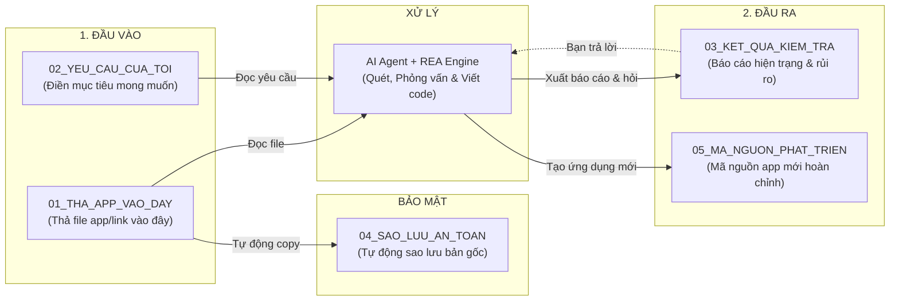

# HƯỚNG DẪN SỬ DỤNG NHANH — REA-KIT-AGY
*(Dành cho người dùng phổ thông — Không cần biết lập trình)*

---

## 1. SƠ ĐỒ LUỒNG HOẠT ĐỘNG TRỰC QUAN



---

## 2. BA BƯỚC THỰC HIỆN CƠ BẢN

1. **Bước 1**: Kéo file ứng dụng của bạn (file `.apk`, `.zip`, mã nguồn, gói cài đặt) vào thư mục:
   👉 **`01_THA_APP_VAO_DAY`**
2. **Bước 2**: Mở chat với AI, copy một trong các mẫu câu lệnh bên dưới và dán vào.
3. **Bước 3**: Xem báo cáo tại 👉 **`03_KET_QUA_KIEM_TRA`** và nhận mã nguồn tại 👉 **`05_MA_NGUON_PHAT_TRIEN`**.

---

## 3. BẢNG CÂU LỆNH TỰ DÁN THEO TỪNG BƯỚC (COPY-PASTE)

### 📌 LỆNH 1: Kiểm tra & Báo cáo hiện trạng ứng dụng
*(Dán lệnh này sau khi vừa thả file vào thư mục 01)*
```markdown
Hãy kích hoạt kỹ năng rea-scan để kiểm tra ứng dụng trong thư mục 01_THA_APP_VAO_DAY:
1. Tự động sao lưu file gốc sang 04_SAO_LUU_AN_TOAN/.
2. Nhận diện định dạng tệp và gọi công cụ phân tích phù hợp từ REA.
3. Xuất báo cáo tính năng đã xác minh (Feature Map) vào 03_KET_QUA_KIEM_TRA/.
4. Trình bày tóm tắt cho tôi bằng tiếng Việt dễ hiểu, dạng gạch đầu dòng, không xả log kỹ thuật.
```

---

### 📌 LỆNH 2: Đánh giá rủi ro bảo mật
*(Dán lệnh này để rà soát quyền hạn và nguy cơ rò rỉ thông tin)*
```markdown
Dựa trên kết quả phân tích ứng dụng trong thư mục 01_THA_APP_VAO_DAY:
1. Rà soát các quyền hạn hệ thống (Permissions) mà app yêu cầu xem có quyền nào bất thường không.
2. Kiểm tra xem có API keys, đường dẫn server thiếu an toàn (HTTP) hay dữ liệu nhạy cảm bị lộ không.
3. Liệt kê rõ: Các điểm an toàn, các điểm rủi ro cần khắc phục, và những phần chưa thể kiểm tra nếu không chạy runtime.
```

---

### 📌 LỆNH 3: Phỏng vấn làm rõ yêu cầu (Hỏi thiếu gì, cần nâng gì)
*(Dán lệnh này để AI phỏng vấn mong muốn của bạn và chốt hướng phát triển)*
```markdown
Hãy kích hoạt kỹ năng rea-interview:
1. Đọc báo cáo trong 03_KET_QUA_KIEM_TRA/ và file 02_YEU_CAU_CUA_TOI/ho-so-va-muc-tieu.md.
2. Phỏng vấn tôi lần lượt theo 4 câu hỏi:
   - App còn thiếu tính năng gì?
   - Cần nâng cấp giao diện hoặc công nghệ ra sao?
   - Yêu cầu bảo mật và bảo vệ dữ liệu thế nào?
   - Đề xuất: Nên giữ nguyên app cũ hay Viết lại hoàn toàn (Rewrite)?
3. Hỏi ngắn gọn từng câu một để tôi dễ trả lời.
```

---

### 📌 LỆNH 4: Tiến hành viết code / Viết lại app
*(Dán lệnh này sau khi bạn đã trả lời xong các câu hỏi ở Lệnh 3)*
```markdown
Hãy kích hoạt kỹ năng rea-build để tiến hành phát triển ứng dụng:
1. Đọc đặc tả yêu cầu đã chốt trong 03_KET_QUA_KIEM_TRA/.
2. Viết mã nguồn hoàn chỉnh vào thư mục 05_MA_NGUON_PHAT_TRIEN/.
3. Chạy kiểm tra cú pháp và kiểm thử các tính năng mới.
4. Viết file 05_MA_NGUON_PHAT_TRIEN/HUONG_DAN_CHAY_APP.md (đúng 1 trang) chỉ tôi cách chạy thử app.
```

---

### 📌 LỆNH 5: Mở phiên chat mới không bị mất bài
*(Dán đoạn này vào đầu cửa sổ chat mới)*
```markdown
BẠN ĐANG LÀM VIỆC TRONG DỰ ÁN: REA-kit-agy (https://github.com/kimducanh27-cpu/REA-kit-agy)
Đọc AGENTS.md, docs/HANDOFF.md và docs/PROGRESS.md rồi báo cáo nhiệm vụ tiếp theo cho tôi.
```

---

## 4. XỬ LÝ NHANH KHI CẦN
- **Muốn dừng lại hoặc khôi phục:** Gõ *"Dừng lại và khôi phục từ 04_SAO_LUU_AN_TOAN"*.
- **Kiểm tra trạng thái hệ thống:** Chạy đúp chuột vào file `KIEM_TRA.bat`.
