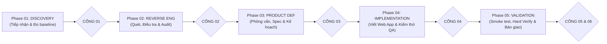

# HƯỚNG DẪN SỬ DỤNG NHANH — REA-KIT-AGY
*(Dành cho người dùng phổ thông — Không cần biết lập trình)*

---

## 1. SƠ ĐỒ LUỒNG 6 PHASE · 14 BƯỚC



---

## 2. BA BƯỚC THỰC HIỆN CƠ BẢN

1. **Bước 1**: Kéo file ứng dụng của bạn (file `.apk`, `.zip`, `.asar`, hoặc link web) vào thư mục:
   👉 **`01_THA_APP_VAO_DAY`**
2. **Bước 2**: Mở chat với AI, copy câu lệnh mẫu từ thư mục `prompts/` theo thứ tự từ Tab 01 đến Tab 05.
3. **Bước 3**: Trả lời các câu hỏi làm rõ từ AI, xem báo cáo tại 👉 **`03_KET_QUA_KIEM_TRA`** và nhận ứng dụng hoàn thiện tại 👉 **`05_MA_NGUON_PHAT_TRIEN`**.

---

## 3. BẢNG CÂU LỆNH TỰ DÁN THEO 5 TAB (COPY-PASTE)

### 📌 TAB 01: Khám phá & Đo kiểm Baseline (Phase 01)
*(Mở file `prompts/01-TAB-DISCOVERY.md` hoặc copy đoạn dưới đây)*
```markdown
# Tab 01 — Phase 01: Discovery (Bước 01: App Intake & Bước 02: Reference Baseline)
Read and follow AGENTS.md and docs/WORKFLOW_LIFECYCLE.md.
Activate Skill rea-scan.
1. Tiếp nhận file trong 01_THA_APP_VAO_DAY/, sao lưu an toàn sang 04_SAO_LUU_AN_TOAN/.
2. Thử chạy app gốc, chụp màn hình baseline. Nếu không có máy ảo/runtime thì Fallback bóc tách tài nguyên tĩnh và đánh dấu SKIPPED (Tĩnh).
3. Đóng CỔNG 01 (gate_01_baseline_verified = true), cập nhật docs/PROGRESS.md và báo cáo bằng tiếng Việt đời thường.
```

---

### 📌 TAB 02: Bóc tách cấu trúc & Dịch ngược chuyên sâu (Phase 02)
*(Mở file `prompts/02-TAB-REVERSE-ENGINEERING.md` hoặc copy đoạn dưới đây)*
```markdown
# Tab 02 — Phase 02: Reverse Engineering (Bước 03: Scan, Bước 04: Investigate & Bước 05: Audit)
Read and follow AGENTS.md, REVIEW.md, and docs/WORKFLOW_LIFECYCLE.md.
Activate Skill rea-scan and reverse-engineer-anything.
1. Bước 03: Bóc tách cấu trúc, che mờ bí mật [REDACTED], trích xuất Screen Inventory & State Matrix.
2. Bước 04: Điều tra luồng nghiệp vụ, API endpoints và lưu trữ dữ liệu.
3. Bước 05: Kiểm toán bằng chứng, đo Coverage Score, xuất 03_KET_QUA_KIEM_TRA/UNKNOWNS_AND_COVERAGE.md và bao-cao-hien-trang.md.
4. Đóng CỔNG 02 (gate_02_audit_passed = true) và cập nhật docs/PROGRESS.md.
```

---

### 📌 TAB 03: Định hình sản phẩm & Lập kế hoạch (Phase 03)
*(Mở file `prompts/03-TAB-PRODUCT-DEFINITION.md` hoặc copy đoạn dưới đây)*
```markdown
# Tab 03 — Phase 03: Product Definition (Bước 06: Interview, Bước 07: Spec & Design & Bước 08: Implementation Plan)
Read and follow AGENTS.md, REVIEW.md, and docs/WORKFLOW_LIFECYCLE.md.
Activate Skill rea-interview.
1. Bước 06: Phỏng vấn tôi từ 3 đến 5 câu hỏi tiếng Việt dựa trên hồ sơ mong muốn và sổ Unknowns.
2. Bước 07: Chốt Design System 3 tầng vào 02_YEU_CAU_CUA_TOI/design.md và xuất 03_KET_QUA_KIEM_TRA/dac-ta-yeu-cau-da-chot.md.
3. Bước 08: Chia nhỏ task nguyên tử, xuất 03_KET_QUA_KIEM_TRA/KE_HOACH_TRIEN_KHAI.md.
4. Chờ tôi duyệt để đóng CỔNG 03 (gate_03_spec_frozen = true) và đồng bộ docs/PROGRESS.md.
```

---

### 📌 TAB 04: Viết mã nguồn & Kiểm toán độc lập (Phase 04)
*(Mở file `prompts/04-TAB-IMPLEMENTATION.md` hoặc copy đoạn dưới đây)*
```markdown
# Tab 04 — Phase 04: Implementation (Bước 09: REA Build & Bước 10: Build QA / Code Review)
Read and follow AGENTS.md, REVIEW.md, and docs/WORKFLOW_LIFECYCLE.md.
Activate Skill rea-build.
1. Bước 09: Lưu snapshot vào .backup/, viết mã Web App Zero-Install vào 05_MA_NGUON_PHAT_TRIEN/, tuân thủ design.md và 4 trạng thái UI. Xuất preview.html nếu là bản sửa đổi.
2. Bước 10: Thẩm định độc lập 2 trục theo REVIEW.md, chạy verify_code.ps1, áp dụng bộ lọc dẹp nhiễu, khống chế 2 vòng tự sửa. Chặn đứng nếu gặp cú pháp lỗi hoặc HIGH RISK.
3. Xuất 03_KET_QUA_KIEM_TRA/KET_QUA_KIEM_THU.md.
4. Đóng CỔNG 04 (gate_04_build_qa_passed = true) và cập nhật docs/PROGRESS.md.
```

---

### 📌 TAB 05: Nghiệm thu đối chiếu & Bàn giao trọn gói (Phase 05)
*(Mở file `prompts/05-TAB-VALIDATION.md` hoặc copy đoạn dưới đây)*
```markdown
# Tab 05 — Phase 05: Validation (Bước 11: Smoke Test, Bước 12: Hard Verify & Bước 13: Release & Handoff)
Read and follow AGENTS.md, REVIEW.md, and docs/WORKFLOW_LIFECYCLE.md.
Activate Skill rea-build.
1. Bước 11: Hướng dẫn tôi nhấp đúp mở app 05_MA_NGUON_PHAT_TRIEN/index.html trên trình duyệt để kiểm tra luồng chính.
2. Bước 12: Hard Verify đối chiếu 1-1 với app gốc theo 3 cột, xuất 03_KET_QUA_KIEM_TRA/BAO_CAO_NGHIEM_THU_HARD_VERIFY.md. Mở CỔNG 05 (gate_05_hard_verify_passed = true).
3. Bước 13: Đóng gói hoàn chỉnh, viết Explainer đời thường, hướng dẫn HOAN_TAC.bat, xuất 05_MA_NGUON_PHAT_TRIEN/BAN_GIAO_SAN_PHAM.md. Mở CỔNG 06 (gate_06_handoff_signed = true).
4. Đồng bộ hóa toàn bộ thông tin vào docs/PROGRESS.md và docs/HANDOFF.md.
```

---

## 4. HAI CÔNG CỤ 1-CLICK DÀNH CHO BẠN TRÊN WINDOWS

- 🩺 **`KIEM_TRA.bat`**: Nhấp đúp chuột để kiểm tra sức khỏe hệ thống (Workspace, REA engine, và tự động xem bạn đang ở bước nào trong 14 bước).
- ⏪ **`HOAN_TAC.bat`**: Nhấp đúp chuột để lập tức khôi phục toàn bộ mã nguồn về phiên bản chạy tốt gần nhất nếu phát sinh lỗi hoặc bạn không ưng ý với bản mới.
