# REA-kit-agy v2.0.0

[](https://github.com/kimducanh27-cpu/REA-kit-agy/releases/tag/v2.0.0)
[-brightgreen.svg)](tests/)
[](src/)
[](src/core/health-check.ts)
[](02_YEU_CAU_CUA_TOI/tokens.json)
[](src/cli.ts)
[-success.svg)](package.json)

**Bộ kit công cụ pháp y ứng dụng, phỏng vấn nhu cầu thích ứng có cấu trúc, và phát triển/viết lại app bằng AI (Google Antigravity & REA Engine) theo chuẩn 6 Giai đoạn · 14 Bước — Phiên bản 2.0.0 chuyển đổi toàn diện sang kiến trúc Hybrid npm CLI + MCP Server chạy đa nền tảng.**

---

## 🌟 Đột Phá Kiến Trúc v2.0.0 (Hybrid npm CLI + MCP Server)

1. **Đa nền tảng thuần túy (Cross-platform Native)**:
   - Viết 100% bằng TypeScript strict mode (`NodeNext`), chạy độc lập trên Windows, Linux và macOS chỉ cần Node.js (>= 18).
   - Loại bỏ hoàn toàn sự phụ thuộc vào PowerShell Core (`pwsh`) trên môi trường Unix/macOS.
2. **Hybrid CLI + MCP Server**:
   - **Giao diện Dòng lệnh (CLI)**: Lệnh `rea-kit <command>` trực quan cho người dùng và CI/CD (`init`, `check`, `health`, `compile-tokens`, `verify`, `rollback`, `gate`, `context`, `interview`).
   - **Model Context Protocol (MCP) Server**: Lệnh `rea-kit serve` công bố 8 tools chuẩn `kit_*` cho AI Coding Agents giao tiếp thời gian thực, đã cấu hình sẵn trong `.agents/mcp_config.json`.
3. **Quản trị Concurrency & Chống Race Condition**:
   - Mọi thao tác ghi tệp trạng thái `.agents/state/*.json` và `.agents/state/events.jsonl` bắt buộc đi qua `withFileLock` (khóa tệp độc quyền cờ `wx` kèm stale lock cleanup) và `writeUtf8NoBomAtomic` (ghi nguyên tử 2 bước).
   - Tuyệt đối không sinh byte UTF-8 BOM (`EF BB BF`) trong bất kỳ file cấu hình, XML, CSS hay Kotlin nào.
4. **Chuẩn hóa W3C Design Tokens Community Group (DTCG) & WCAG AA**:
   - Đọc đệ quy thuộc tính `$value`, giải tham chiếu alias đa tầng dạng `{global.color.*}` / `{semantic.color.*}` tối đa 10 passes.
   - Kiểm định độ tương phản WCAG AA ($\ge 4.5:1$) theo danh sách cặp ngữ nghĩa (`semanticContrastPairs`) thay vì tích Đề-các bừa bãi.
5. **Kế thừa 100% Nghiệp vụ v1.2**:
   - Bộ 8 Micro-prompts tinh gọn (`prompts/QUICK-PROMPTS.md` `QP-01` → `QP-08`).
   - Khung đặc tả luồng ứng dụng App Flow Spec (`templates/15-APP-FLOW-SPEC-TEMPLATE.md`).
   - 6 Cổng kiểm soát chất lượng DAG và Động cơ phỏng vấn thích ứng 13 actions.
6. **Bộ Kiểm Thử Tự Động Vitest 97/97 PASS (100%)**:
   - Port toàn bộ test sang `vitest`, chạy cô lập 100% trong `os.tmpdir()`, không làm biến đổi hay ô nhiễm `.agents/state/` của repo.

---

## 1. Sơ đồ Luồng Vòng Đời 6 Giai Đoạn · 14 Bước (Master Lifecycle)

```mermaid
flowchart TD
    subgraph P0["PHASE 00 · FOUNDATION"]
        S00["00. PROJECT BOOTSTRAP<br/>(rea-kit init, Git, Workspace, MCP Server)"]
    end

    subgraph P1["PHASE 01 · DISCOVERY (Tab 01)"]
        S01["01. APP INTAKE / PREFLIGHT<br/>(Nhận app, kiểm tra file, sao lưu an toàn)"]
        S02["02. REFERENCE BASELINE<br/>(Chạy thử app gốc, chụp ảnh UI / Fallback tĩnh)"]
        G1{"CỔNG 01: Baseline Verified?"}
    end

    subgraph P2["PHASE 02 · REVERSE ENGINEERING (Tab 02)"]
        S03["03. REA SCAN<br/>(Bóc tách cấu trúc, che mờ [REDACTED], State Matrix)"]
        S04["04. REA INVESTIGATE<br/>(Truy vết hàm nghiệp vụ, API, Data Flow)"]
        S05["05. REA AUDIT<br/>(Kiểm toán bằng chứng, đo Coverage, Sổ Unknowns)"]
        G2{"CỔNG 02: Audit Passed?"}
    end

    subgraph P3["PHASE 03 · PRODUCT DEFINITION (Tab 03)"]
        S06["06. REA INTERVIEW (Adaptive)<br/>(13 Actions, TopicKey, Sufficiency Engine)"]
        EX{"EXIT GATE: Sufficiency Check"}
        S07["07. SPEC & DESIGN GATE<br/>(Mobile Matrix, Tokens W3C 3 tầng, Anti-Slop)"]
        S08["08. IMPLEMENTATION PLAN<br/>(Chia 6 Vertical Slices nguyên tử)"]
        G3{"CỔNG 03: Spec Frozen?"}
    end

    subgraph P4["PHASE 04 · IMPLEMENTATION (Tab 04)"]
        S09["09. REA BUILD<br/>(4 Routes: Extend / Branch / Compatible / Rewrite)"]
        S10["10. BUILD QA / CODE REVIEW<br/>(Thẩm định Standards vs Spec, verify-code)"]
        G4{"CỔNG 04: Build QA Passed?"}
    end

    subgraph P5["PHASE 05 · VALIDATION (Tab 05)"]
        S11["11. RUN APP / SMOKE TEST<br/>(Khởi chạy app mới: Web Zero-Install / Android AVD)"]
        S12["12. HARD VERIFY<br/>(Đối chiếu 1-1 với app gốc: Khớp / Khác biệt / Nâng cấp)"]
        G5{"CỔNG 05: Hard Verify Passed?"}
        S13["13. RELEASE & HANDOFF<br/>(Đóng gói, Explainer đời thường, HOAN_TAC.bat)"]
        G6{"CỔNG 06: Handoff Signed?"}
    end

    S00 --> S01 --> S02 --> G1
    G1 -->|"Đạt"| S03
    S03 --> S04 --> S05 --> G2
    G2 -->|"Đạt / Bỏ qua hợp lệ"| S06
    S06 --> EX
    EX -->|"SUFFICIENT"| S07
    EX -->|"BLOCKED / NEEDS_INPUT"| S06
    S07 --> S08 --> G3
    G3 -->|"Duyệt"| S09
    S09 --> S10 --> G4
    G4 -->|"Đạt"| S11
    S11 --> S12 --> G5
    G5 -->|"Đạt"| S13
    S13 --> G6

    %% Reject / Retry Loops
    G3 -.->|"Sửa Spec (Tạo v2)"| S06
    G4 -.->|"Lỗi cú pháp (Sửa code)"| S09
    G5 -.->|"Chưa khớp app gốc"| S09
```



---

## 2. Bảng Ma Trận 6 Cổng Kiểm Soát Chất Lượng & Interview Exit Gate

| Cổng Kiểm Soát | Vị Trí Vòng Đời | Điều Kiện Vượt Qua (Passing Criteria) | Lệnh CLI Kiểm Tra / Đóng Mở |
| :--- | :--- | :--- | :--- |
| **GATE 01** (`gate_01_baseline_verified`) | Sau Bước 02 | Có ảnh chụp baseline thực tế HOẶC đã bóc tách tài nguyên tĩnh dự phòng. | `rea-kit gate open gate_01_baseline_verified --evidence <sha>` |
| **GATE 02** (`gate_02_audit_passed`) | Sau Bước 05 | Hoàn thành kiểm toán tĩnh; che mờ API Keys `[REDACTED]`; có mỏ neo `[EV: ...]`; cấm dùng `01_` làm bằng chứng. | `rea-kit gate open gate_02_audit_passed --evidence <sha>` |
| **INTERVIEW EXIT GATE** (`evaluate-sufficiency`) | Sau Bước 06 | Đạt verdict **`SUFFICIENT`**; toàn bộ mục tiêu có Decision hoặc Assumption duyệt; 0 mâu thuẫn mở; 0 unknown nguy hiểm. | `rea-kit interview evaluate-sufficiency` |
| **GATE 03** (`gate_03_spec_frozen`) | Sau Bước 08 | Người dùng phê duyệt `APPROVE UI SPEC` và `FREEZE UI SPEC` trên `dac-ta-yeu-cau-da-chot.md` và `KE_HOACH_TRIEN_KHAI.md`. | `rea-kit gate open gate_03_spec_frozen --approved-by "USER_PO"` |
| **GATE 04** (`gate_04_build_qa_passed`) | Sau Bước 10 | Syntax check 100% OK (`rea-kit verify`), Token Drift PASS, WCAG AA $\ge 4.5:1$, Cấp độ rủi ro: `[LOW]`. | `rea-kit gate open gate_04_build_qa_passed` |
| **GATE 05** (`gate_05_hard_verify_passed`) | Sau Bước 12 | Người dùng xác nhận bảng đối chiếu Hard Verify đạt yêu cầu. | `rea-kit gate open gate_05_hard_verify_passed` |
| **GATE 06** (`gate_06_handoff_signed`) | Sau Bước 13 | Người dùng ký nhận bàn giao, đã kiểm tra `HOAN_TAC` sẵn sàng. | `rea-kit gate open gate_06_handoff_signed` |

---

## 3. Cấu Trúc Thư Mục Chuẩn v2.0.0

```text
REA-kit-agy/
├── package.json                       # Cấu hình gói rea-kit-agy v2.0.0 (Pure ESM)
├── tsconfig.json                      # Cấu hình TypeScript NodeNext strict mode
├── dist/                              # Mã JavaScript biên dịch sẵn sàng thực thi
├── src/                               # Toàn bộ mã nguồn TypeScript lõi
│   ├── index.ts                       # Public API export
│   ├── cli.ts                         # Commander CLI đa lệnh (rea-kit)
│   ├── mcp.ts                         # MCP Server Stdio Transport (8 tools)
│   └── core/                          # Phân hệ nghiệp vụ lõi
│       ├── workspace.ts               # Định vị root & resolve 5 thư mục số
│       ├── state-lock.ts              # withFileLock & writeUtf8NoBomAtomic
│       ├── init.ts                    # Khởi tạo workspace 1-click & guardrails
│       ├── health-check.ts            # Đo kiểm sức khỏe 6 điểm chuẩn hóa
│       ├── compile-tokens.ts          # Biên dịch Design Tokens W3C DTCG 3 tầng
│       ├── verify-code.ts             # Deterministic verification & WCAG AA
│       ├── rollback.ts                # Hoàn tác nguyên tử 2 giai đoạn (2-Phase Swap)
│       ├── gate.ts                    # Deterministic Gate Engine & DAG transitions
│       ├── context.ts                 # L0-L5 Context engineering & Token estimator
│       └── interview.ts               # Adaptive Interview Engine (13 actions)
├── tests/                             # Bộ kiểm thử Vitest tự động (97 tests PASS 100%)
│   ├── phase1.test.ts                 # Tokens, verify, health, state-lock
│   ├── phase2.test.ts                 # Rollback, gate DAG, context
│   ├── interview.test.ts              # 52 bài test phỏng vấn thích ứng 3 tầng
│   └── phase4.test.ts                 # Init, MCP config, CLI wrappers
├── 01_THA_APP_VAO_DAY/                # [Phase 01]: Thả APK, ASAR, zip, web link & ảnh baseline
├── 02_YEU_CAU_CUA_TOI/               # [Phase 03]: tokens.json (W3C), design.md, ho-so-va-muc-tieu.md
├── 03_KET_QUA_KIEM_TRA/              # [Phase 02-05]: Báo cáo, Unknowns, Spec chốt, Kế hoạch & Nghiệm thu
├── 04_SAO_LUU_AN_TOAN/               # [Bảo vệ]: Bản sao lưu gốc & snapshot SHA-256 (Chỉ đọc)
├── 05_MA_NGUON_PHAT_TRIEN/           # [Phase 04-05]: Mã nguồn phát triển & bàn giao
├── AGENTS.md                         # Não bộ & luật vận hành 6 Giai đoạn · 14 Bước
├── REVIEW.md                         # Hợp đồng thẩm định độc lập & bộ lọc dẹp nhiễu
├── HUONG_DAN_SU_DUNG.md              # Sổ tay hướng dẫn người dùng non-tech
├── KIEM_TRA.bat / kiem_tra.sh        # 1-click kiểm tra hệ thống (ưu tiên Node CLI)
├── HOAN_TAC.bat / hoan_tac.sh        # 1-click hoàn tác khẩn cấp về bản chạy tốt gần nhất
├── prompts/                          # Bộ câu lệnh điều phối DAG & 8 Micro-prompts
│   ├── QUICK-PROMPTS.md              # 8 Micro-prompts (QP-01 đến QP-08) cho Power User
│   ├── 00-WORKFLOW-ROUTER.md         # Router luồng điều phối (RWO v2)
│   ├── 01-TAB-DISCOVERY.md           # Tab 01: Intake & Baseline
│   ├── 02-TAB-REVERSE-ENGINEERING.md # Tab 02: Scan & Audit
│   ├── 03-TAB-PRODUCT-DEFINITION.md  # Tab 03: Interview, Spec Freeze & Mobile Matrix
│   ├── 04-TAB-IMPLEMENTATION.md      # Tab 04: Build & Code Review
│   └── 05-TAB-VALIDATION.md          # Tab 05: Smoke Test, Hard Verify & Handoff
├── templates/                        # Khung mẫu tài liệu hợp đồng (01 đến 16)
│   ├── 14-INTERVIEW-STATE-TEMPLATE.json # Schema JSON chuẩn cho interview state
│   ├── 15-APP-FLOW-SPEC-TEMPLATE.md     # Mẫu đặc tả luồng ứng dụng App Flow Spec
│   └── 16-TOKENS-TEMPLATE.json          # Mẫu W3C DTCG Design Tokens 3 tầng
└── .agents/                          # Phân hệ kỹ thuật điều phối
    ├── mcp_config.json               # Cấu hình MCP (rea + rea-kit v2.0.0)
    ├── rules/                        # Bộ luật an toàn trigger: always_on
    ├── skills/                       # 7 local skills điều phối tiếng Việt
    ├── state/                        # Trạng thái ca làm việc (active_case.json, events.jsonl)
    └── scripts/                      # Bộ script PowerShell v1.2 tham chiếu
```

---

## 4. Hướng Dẫn Sử Dụng Nhanh

### 4.1 Cài đặt & Khởi động

Yêu cầu máy tính đã cài đặt **Node.js (>= 18)**:

```bash
# 1. Cài đặt các gói phụ thuộc
npm install

# 2. Biên dịch TypeScript sang JavaScript
npm run build

# 3. Chạy toàn bộ 97 bài kiểm thử tự động
npm test
```

### 4.2 Bộ lệnh CLI `rea-kit`

| Lệnh Dòng Lệnh | Mô tả Chức Năng |
| :--- | :--- |
| `node dist/cli.js init [--force]` | Khởi tạo sạch 5 thư mục số và các file trạng thái ban đầu. |
| `node dist/cli.js check` | Đo kiểm sức khỏe 6 điểm chuẩn hóa của workspace (đạt 6/6 điểm). |
| `node dist/cli.js compile-tokens` | Biên dịch `tokens.json` sang CSS, Kotlin Compose, Android XML và cập nhật `design.md`. |
| `node dist/cli.js verify [--target <dir>]` | Quét secret, kiểm tra Token Drift, đo WCAG AA ($\ge 4.5:1$), phân loại rủi ro. |
| `node dist/cli.js rollback snapshot` | Tạo snapshot an toàn kèm mã băm SHA-256 manifest vào `04_SAO_LUU_AN_TOAN/`. |
| `node dist/cli.js rollback restore [--force]` | Khôi phục mã nguồn về snapshot gần nhất bằng 2-Phase Atomic Swap. |
| `node dist/cli.js gate status` | Xem bảng trạng thái 6 cổng kiểm soát DAG và revision hiện hành. |
| `node dist/cli.js gate open <gate> [options]` | Mở cổng kiểm soát có xác thực điều kiện tiên quyết và bằng chứng. |
| `node dist/cli.js context plan --task "<text>"` | Định tuyến intent và sinh kế hoạch phân bổ ngân sách ngữ cảnh L0-L5. |
| `node dist/cli.js interview status` | Xem trạng thái phiên phỏng vấn, mục tiêu, câu hỏi, điểm mù và Exit Gate. |
| `node dist/cli.js interview evaluate-sufficiency` | Đánh giá điều kiện Exit Gate để chốt đặc tả (Spec Freeze). |

### 4.3 Tích hợp MCP Server (`.agents/mcp_config.json`)

REA-kit-agy v2.0.0 tích hợp sẵn MCP Server cung cấp 8 tools cho các AI Coding Agent:

```json
{
  "mcpServers": {
    "rea": {
      "command": "npx",
      "args": ["-y", "rea-agents@6.9.0", "serve"],
      "description": "Reverse Engineer Anything (REA) MCP Server"
    },
    "rea-kit": {
      "command": "node",
      "args": ["dist/mcp.js", "--workspace", "${workspaceFolder}"],
      "description": "REA-kit-agy Hybrid MCP Server v2.0"
    }
  }
}
```

**Danh sách 8 MCP Tools cung cấp:**
1. `kit_init`: Khởi tạo workspace và các file trạng thái chuẩn.
2. `kit_health_check`: Đo kiểm sức khỏe workspace 6 điểm chuẩn hóa.
3. `kit_compile_tokens`: Biên dịch W3C DTCG Design Tokens đa nền tảng.
4. `kit_verify_code`: Kiểm định mã nguồn xác định và đo tương phản WCAG AA.
5. `kit_rollback`: Tạo bản sao lưu an toàn hoặc hoàn tác nguyên tử 2 giai đoạn.
6. `kit_gate`: Quản trị máy trạng thái 6 cổng kiểm soát DAG và nhật ký sự kiện.
7. `kit_context_plan`: Định tuyến intent và lập kế hoạch lắp ráp ngữ cảnh L0-L5.
8. `kit_interview`: Thực thi 13 actions của động cơ phỏng vấn thích ứng và Exit Gate.

---

## 5. Tải Về Bản Phát Hành (Download v2.0.0)

- **Trực tuyến (GitHub Release)**: [https://github.com/kimducanh27-cpu/REA-kit-agy/releases/tag/v2.0.0](https://github.com/kimducanh27-cpu/REA-kit-agy/releases/tag/v2.0.0)
- **Tải trực tiếp file zip**: [REA-kit-agy-v2.0.0.zip](https://github.com/kimducanh27-cpu/REA-kit-agy/releases/download/v2.0.0/REA-kit-agy-v2.0.0.zip)
