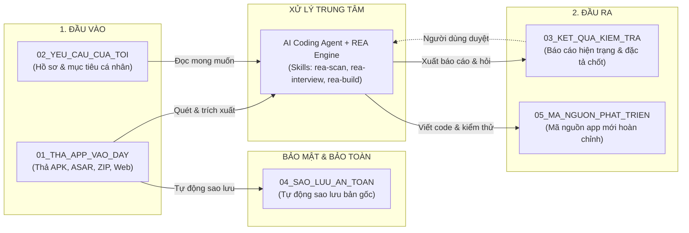

# REA-kit-agy

**Bộ kit giao diện thư mục trực quan dành cho người dùng non-tech: Kiểm tra ứng dụng, đánh giá bảo mật, làm rõ yêu cầu và phát triển/viết lại app bằng AI (Google Antigravity & REA Engine).**

---

## 1. Sơ đồ luồng hoạt động trực quan



---

## 2. Cấu trúc thư mục chuẩn (Self-Explanatory Tree)

```text
REA-kit-agy/
├── 01_THA_APP_VAO_DAY/             # Input: Nơi thả APK, ASAR, file zip hoặc link web
├── 02_YEU_CAU_CUA_TOI/            # Context: Form điền khuyết mục tiêu kiểm tra
├── 03_KET_QUA_KIEM_TRA/           # Output: Báo cáo tính năng, bảo mật và đặc tả đã chốt
├── 04_SAO_LUU_AN_TOAN/            # Backup: Bản sao lưu gốc bất khả xâm phạm
├── 05_MA_NGUON_PHAT_TRIEN/        # Build: Nơi lưu mã nguồn app mới và hướng dẫn chạy
├── AGENTS.md                      # Não bộ & luật giao tiếp tiếng Việt phi kỹ thuật
├── CLAUDE.md                      # Tương thích Claude Code (@AGENTS.md)
├── REVIEW.md                      # Hợp đồng thẩm định độc lập & bộ lọc dẹp nhiễu
├── UPSTREAMS.md                   # Đăng ký chuẩn nguồn gốc morluto/rea
├── HUONG_DAN_SU_DUNG.md           # Hướng dẫn sử dụng 1 trang kèm câu lệnh copy-paste
├── KIEM_TRA.bat                   # 1-click kiểm tra sức khỏe workspace & runtime (6/6)
├── HOAN_TAC.bat                   # 1-click hoàn tác về bản chạy tốt gần nhất (Rollback)
├── .gitignore                     # Bảo vệ bản quyền và chống rò rỉ dữ liệu cá nhân
├── prompts/                       # Bộ câu lệnh dán theo từng tab/giai đoạn (00 đến 05)
├── templates/                     # Khung mẫu tài liệu hợp đồng chuẩn (01 đến 05)
├── docs/                          # Hệ thống quản lý ngữ cảnh đa phiên (Context Docs)
└── .agents/                       # Khu vực kỹ thuật (ẩn trên Windows)
    ├── rules/rea-workflow.md      # Luật an toàn REA
    ├── skills/                    # Kỹ năng lõi REA gốc + Bộ 3 skills điều phối tiếng Việt
    ├── state/active_case.json     # Bộ nhớ trạng thái tự động nối lại phiên làm việc
    └── scripts/health_check.ps1   # Script kiểm tra môi trường và runtime (6/6)
```

---

## 3. Kiến trúc 2 tầng Kỹ năng (Engine & Orchestration Skills)

* **Tầng 1 — Kỹ năng lõi Upstream (`reverse-engineer-anything`)**:
  - Sao chép nguyên văn từ `morluto/rea` (SHA `5cddc69c51a0fb18d021417199046314581ba9c2`), gồm 229 MCP tools, hướng dẫn định tuyến dịch ngược APK, Electron ASAR, Native binaries và 7 tài liệu kỹ thuật trong `references/`.
* **Tầng 2 — Bộ 3 Kỹ năng điều phối tiếng Việt (Orchestration Skills)**:
  1. **`rea-scan`**: Nhận diện file đầu vào, sao lưu sang `04_`, gọi công cụ REA/mã nguồn phù hợp, tự động che mờ API keys thành `[REDACTED]`, trích xuất **Screen Inventory & State Matrix** (theo chuẩn app-adr-ui), và xuất báo cáo hiện trạng vào `03_`.
  2. **`rea-interview`**: Đọc báo cáo và `02/ho-so-va-muc-tieu.md`, phỏng vấn người dùng (thiếu gì, cần nâng gì, bảo mật ra sao), chốt hợp đồng thiết kế **Design System 3 tầng (`design.md`)**, và xuất file đặc tả yêu cầu đã chốt.
  3. **`rea-build`**: Triển khai mã nguồn vào `05_` tuân thủ nghiêm ngặt **Design System 3 tầng & 4 trạng thái UI (Loading, Empty, Success, Error)**, chạy kiểm chứng 4 tầng (`verify_code.ps1`), và xuất hướng dẫn chạy app 1 trang.

---

## 4. Năm chốt chặn bảo vệ chất lượng theo chuẩn Anthropic

* **Zero-Install Runtime**: Khi viết lại app mới (Rewrite), Agent ưu tiên xuất ra **Web App độc lập (HTML/CSS/JS)** để người dùng chỉ cần nhấp đúp chuột là mở chạy ngay trên trình duyệt mà không cần cài Node.js hay Python.
* **Provider Fallback Gate**: Nếu máy người dùng thiếu Java/JADX hoặc Ghidra, Agent tự động chuyển sang đọc tài nguyên tĩnh nhẹ nhàng, không quăng lỗi crash terminal.
* **Design System 3 Tầng**: Mọi giao diện đều được quản lý bằng `design.md` (Tokens ➔ Components ➔ 4 Trạng thái UI), đảm bảo app không bao giờ bị đơ hoặc trắng trang.
* **Cổng thẩm định độc lập & Bộ lọc dẹp nhiễu (REVIEW.md)**: Thẩm định 2 trục (Standards & Spec) theo `REVIEW.md`, cấm bắt bẻ phong cách viết mã râu ria. Khống chế tối đa 2 vòng tự sửa để chống lặp vô tận đốt token.
* **Xem trước Staged Preview & Hoàn tác 1-Click (`HOAN_TAC.bat`)**: Xuất `preview.html` xem thử trước khi ghi đè `index.html`. Tự động lưu snapshot vào `.backup/`, hỗ trợ khôi phục tức thì và nạp bài học vào `learned_rules.json` (Incidents to Evals).

---

## 5. Bắt đầu nhanh trong 3 bước

1. Kéo thả file ứng dụng vào thư mục `01_THA_APP_VAO_DAY`.
2. Mở file [HUONG_DAN_SU_DUNG.md](HUONG_DAN_SU_DUNG.md) hoặc [prompts/01-TAB-SCAN.md](prompts/01-TAB-SCAN.md), copy câu lệnh mẫu và dán vào chat với AI.
3. Trả lời các câu hỏi làm rõ từ AI và nhận ứng dụng hoàn thiện tại `05_MA_NGUON_PHAT_TRIEN`.

---

## 6. Khởi tạo bộ kit vào thư mục mới (Meta-Bootstrap)

Muốn nhân bản toàn bộ bộ kit này sang một thư mục rỗng bất kỳ chỉ bằng 1 câu lệnh cho AI:
👉 Mở file **[prompts/BOOTSTRAP_KIT.md](prompts/BOOTSTRAP_KIT.md)**, copy khối siêu lệnh và dán vào Agent trong thư mục mới. Agent sẽ tự động tạo đủ cấu trúc, kiểm tra sức khỏe và báo kết quả `6/6 PASSED`.

---

## Nguồn gốc & Giấy phép
* **Upstream Engine**: [morluto/rea](https://github.com/morluto/rea) (Commit `5cddc69c51a0fb18d021417199046314581ba9c2`, MIT). Chi tiết xem tại [UPSTREAMS.md](UPSTREAMS.md).
* **Quy tắc phát triển**: *"Upstream-first, orchestration-second"*, tham khảo cấu trúc chuẩn từ [kimducanh27-cpu/app-adr-ui](https://github.com/kimducanh27-cpu/app-adr-ui).
