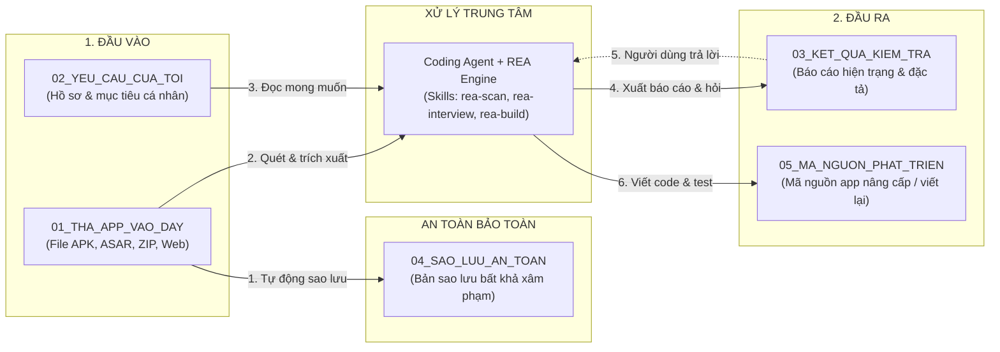
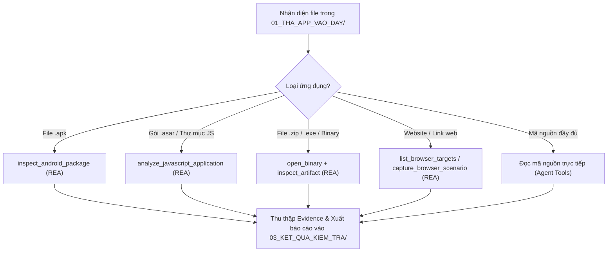
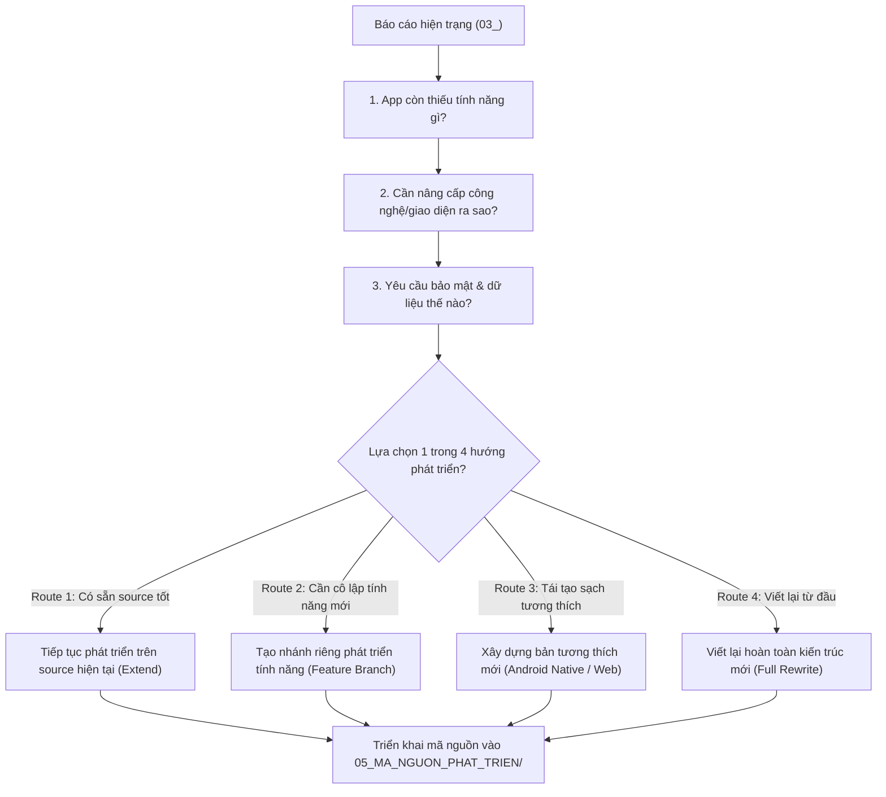
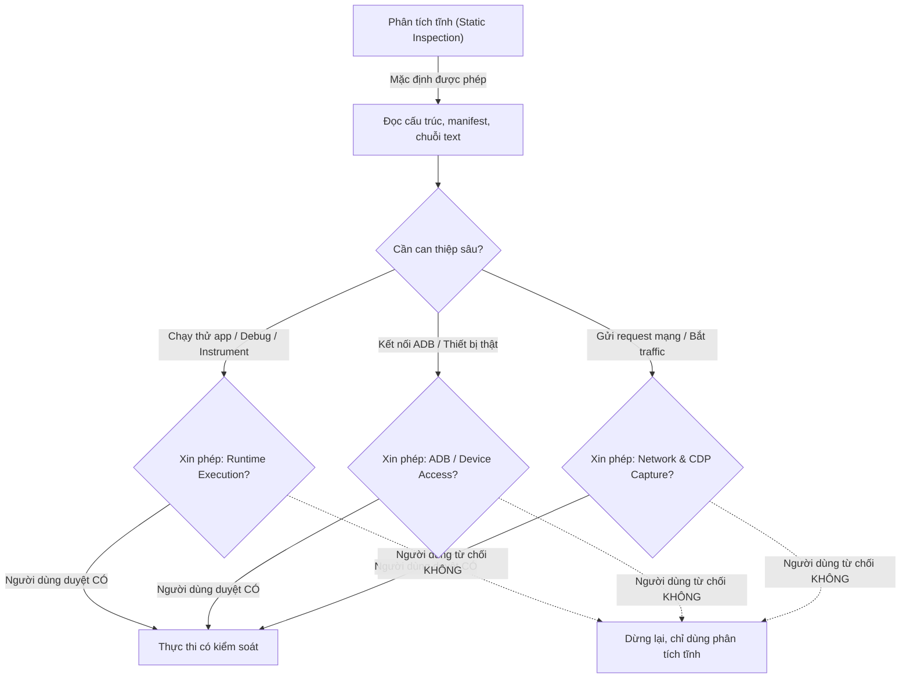

# ARCHITECTURE — REA-kit-agy

- Status: ACCEPTED (ADR-0001 through ADR-0006 approved)
- Last updated: 2026-11-13
- Upstream baseline: morluto/rea main SHA 5cddc69c51a0fb18d021417199046314581ba9c2; package 6.9.0

## 1. System boundary

Three cooperating parts:

1. REA upstream: reverse-engineering/observation tools via MCP and CLI, returning structured Evidence.
2. Coding agent: source repository inspection, reasoning, user interview, design, implementation and tests.
3. REA-kit-agy: Vietnamese-first process connecting intake, target routing, evidence interpretation, assessment, approval, build decisions and handoff.

The kit should orchestrate REA rather than fork its analysis engine.

## 2. Logical layers

### Intake
Collect target locator/type, supplied files/repository, goal, ownership/authorization and constraints. Classify source repository, packaged artifact, live runtime/browser/device or capture. Record allowed operation classes. Never request secrets.

### REA adapter
Discover actual MCP tools and provider readiness. Follow the current upstream Skill and version-matched guides. Use CLI only when MCP is unavailable or the upstream workflow requires it. Preserve Evidence IDs, provider/version, authority, provenance, coverage, limitations and unknowns. Do not hard-code a stale tool catalog.

### Source inspection
When source is supplied, use normal coding-agent repository inspection for architecture, code, dependencies and tests. The upstream REA Skill says to skip REA for ordinary source-repository architecture analysis. Use REA for relevant shipped artifacts, runtime behavior, feature tracing or version reconciliation.

### Evidence/report
Classify claims as observed, static inference, runtime observed, user-provided, partial, unknown or not assessed. Retain original Evidence. Produce app map, feature findings, improvement backlog, scoped security review, limitations and next questions.

### Interview/decisions
Generate questions from unresolved decisions. Link each question to the evidence gap it resolves. Record accepted answers and assumptions; reopen a decision if later evidence contradicts it.

### Planning/build
Compare extend-existing, focused feature branch, new implementation and rewrite. Approve requirements, non-goals, UX, architecture, tests and files in scope before edits. Implement in an isolated branch or safe copy.

### Verification/handoff
Run tests and independent review. Report pass, fail, blocked, partial and not-run separately. Provide change summary, limitations, residual risks, release instructions and rollback.

## 3. End-to-end data flow

Intake and authorization → target classification/preflight → permitted REA and source workflows → Evidence collection → findings report → targeted questions → owner decisions → approved specification → isolated implementation → tests and hard review → scoped security reassessment → handoff.

No later phase silently expands permissions. A new runtime, device, account, network or destructive operation requires separate approval.

## 4. REA integration rules

- Prefer official sources: https://github.com/morluto/rea and https://www.npmjs.com/package/rea-agents.
- Use setup preview/plan and explicit approval.
- Prefer local stdio MCP. Do not expose HTTP MCP to public or untrusted networks.
- Check installed version and actual tool catalog before using version-dependent tools.
- Keep upstream REA Skill upstream-owned; install through its supported distribution path. Kit-specific Vietnamese workflows are original content.
- Unsupported target/provider means explain the blocker or fallback; never fabricate results.

### MCP discovery and effects

- `tools/list` is canonical for complete tool definitions and schemas. `binary_session` and `result.tool_availability` describe current host/provider/target/client availability; request `detail: "complete"` when effect/annotation fields or provider remediation are needed.
- If hot/cold discovery is enabled, load exact tools through `discover_tools`. Respect configured `REA_MCP_TOOL_FAMILIES`; excluded tools are not callable merely because they exist upstream.
- Effect annotations are descriptive hints, not authorization controls. Static target analysis can launch an REA-owned worker or write temporary files without executing supplied app code.
- Preserve Evidence identity, authority, provenance, coverage, limitations and unknowns through every projection/page.
## 5. Target routing examples

Exact routes depend on the installed REA version and its Skill:
- JavaScript/Electron directory or ASAR: static application analysis and feature tracing.
- Android APK: static package/manifest/class analysis via documented provider route.
- Android device: ADB workflows only with separate device authorization.
- Website in a user-owned Chrome-family browser: passive CDP observation, not generic remote browser control.
- .NET/native/desktop/firmware and other formats: only documented target/provider route.
- Ordinary source repository: coding-agent source inspection first.

Maintain a capability matrix with version, platform, prerequisites, operation effects, test status and gaps.

## 6. Per-app case record & Handoff Contract Layout

A case retains target identity/authorization, input references and hashes, complete Evidence exports/index, human report, questions/decisions, requirements/design, implementation branch, tests and handoff. 

The canonical artifact layout inside `03_KET_QUA_KIEM_TRA/` uses a flat, non-tech-friendly structure mapped directly in `.agents/state/active_case.json` (matching `docs/WORKFLOW_LIFECYCLE.md` and `templates/10-CASE-MANIFEST-TEMPLATE.json`):
```text
03_KET_QUA_KIEM_TRA/
├── bao-cao-hien-trang.md                # Sản phẩm Bước 04 (Báo cáo hiện trạng & Evidence IDs — templates/01)
├── UNKNOWNS_AND_COVERAGE.md             # Sản phẩm Bước 05 (Sổ theo dõi điểm mù & Coverage Score — templates/06)
├── dac-ta-yeu-cau-da-chot.md            # Sản phẩm Bước 07 (Đặc tả đóng băng, Strategy & Build Route — templates/02)
├── KE_HOACH_TRIEN_KHAI.md               # Sản phẩm Bước 08 (Kế hoạch 6 Vertical Slices nguyên tử — templates/07)
├── KET_QUA_KIEM_THU.md                  # Sản phẩm Bước 10 (Chứng chỉ QA & Independent Review — templates/04)
└── BAO_CAO_NGHIEM_THU_HARD_VERIFY.md    # Sản phẩm Bước 12 (Bảng đối chiếu 1-1 Hard Verify — templates/08)
```

Never store real user artifacts, private Evidence, source code or secrets in this public repository. Use synthetic/public fixtures.

## 6.1. Chuỗi truy vết 1-1 (End-to-End Traceability Chain)

Mọi yêu cầu nghiệp vụ đều phải có khả năng truy vết 2 chiều thông suốt:
```text
APP ORIGINAL
   ↓
REA EVIDENCE (ID, Provenance)
   ↓
FEATURE FINDING (Screen/Flow)
   ↓
USER DECISION (Decision Log)
   ↓
APPROVED REQUIREMENT (Spec Frozen)
   ↓
IMPLEMENTATION TASK (Atomic Task)
   ↓
SOURCE CODE / COMMIT (Diff)
   ↓
TEST CASE (Automated / Manual)
   ↓
TEST RESULT (QA Pass/Fail)
   ↓
FINAL ACCEPTANCE (Hard Verify 1-1)
```

## 6.2. Phân loại Script Registry (Hiện diện Thực tế vs Lộ trình Dự kiến)

### A. Bộ Script Khả Dụng Trong Gói (`.agents/scripts/` — Đã kiểm thử & Vận hành):
1. **`health_check.ps1`**: Kiểm định môi trường workspace, cấu trúc thư mục, rules (`trigger: always_on`), kỹ năng, tài liệu ngữ cảnh, và đăng ký REA MCP.
2. **`adr.ps1`**: Quản trị danh mục Quyết định Kiến trúc chuẩn MADR (`list`, `show`, `new`, `validate`, `status`).
3. **`gate.ps1`**: Quản trị máy trạng thái 6 cổng kiểm soát, cưỡng chế thứ tự tuần tự, ghi nhận bằng chứng SHA-256, thực thi tự động thu hồi cổng khi reject loop (`validate`, `status`, `open`, `reject`, `event`), và đồng bộ `events.jsonl`.
4. **`rollback.ps1`**: Khôi phục mã nguồn nguyên tử 2 giai đoạn (Staging Atomic Swap) kèm tệp `manifest.json` SHA-256, bảo vệ ReparsePoint (symlink/junction) và chống hoàn tác vào snapshot rỗng.
5. **`verify_code.ps1`**: Kiểm tra xác định mã nguồn (cú pháp HTML, cú pháp JS qua `node --check` hoặc heuristic ngoặc nhọn, quét rò rỉ secret nhạy cảm [REDACTED], phân loại rủi ro tự động LOW/MEDIUM/HIGH, và cấu trúc Android).

### B. Lộ trình Mở rộng Tương lai (`[PLANNED / ROADMAP]`):
- **Intake**: `preflight.ps1`, `verify-backup.ps1` (Tự động hóa sâu checksum cho các định dạng binary phức tạp ngoài APK).
- **Evidence**: `validate-evidence.py`, `validate-report.py`, `validate-coverage.py` (Parser AST chuyên sâu cho Evidence ID).
- **Workflow**: `validate-handoff.py` (Tự động ký số điện tử hợp đồng bàn giao).
- **Memory**: `memory-eval.py` (Đo lường độ lệch tri thức tự động khi kích thước transcript vượt 100MB).

## 7. Security boundaries

REA is local and uses host permissions; it is not a sandbox or multi-tenant authorization system. Treat targets and Evidence as hostile input. Static parsing, external-provider execution and runtime interaction have different effects. MCP host approvals do not replace the kit's scope and consent process.

See SECURITY_REVIEW_MODEL.md and upstream SECURITY.md / DISCLAIMER.md.

## 8. Architectural decisions & delivery model

### Delivery model — ACCEPTED (referencing ADR-0002)

- **Skill-first over upstream REA MCP (ACCEPTED via ADR-0002):** The kit delegates tool execution directly to upstream REA via local stdio MCP (`tools/list`, `binary_session`, `discover_tools`) and provides native Vietnamese orchestration skills (`rea-scan`, `rea-audit`, `rea-interview`, `rea-plan`, `rea-build`, `memory-consolidation`), Markdown prompt templates, and lightweight PowerShell helper scripts.
- **Thin CLI wrapper (REJECTED for V1 via ADR-0002):** A custom binary or npm package wrapper is rejected for V1 to eliminate premature abstraction, compilation, and maintenance overhead.
- **Status:** ACCEPTED. The Skill-first delivery model is approved per ADR-0002.

Other formalized architectural decisions: multi-target architecture with `ANDROID_APK` first target (ADR-0001, ADR-0005); 4-tier hybrid local memory (ADR-0003); single authoritative coordinator agent model (ADR-0004); and markdown-based CLI ADR management (ADR-0006).

## 9. Sơ đồ kiến trúc & Quy trình (Mermaid Visual Architecture)

### 9.1 Sơ đồ luồng người dùng & thư mục (User & Folder Dataflow)



### 9.2 Sơ đồ định tuyến công cụ REA (Target Routing Architecture)



### 9.3 Sơ đồ phỏng vấn & Lựa chọn hướng phát triển (Interview & 4 Build Routes)



### 9.4 Sơ đồ cổng kiểm soát an toàn & Cấp quyền (Security Gates)


