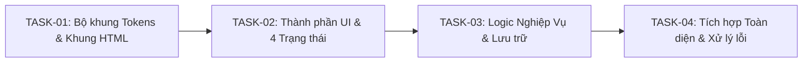

# KẾ HOẠCH TRIỂN KHAI NGUYÊN TỬ (ATOMIC IMPLEMENTATION PLAN)
> **Dự án**: [Tên Ứng Dụng]  
> **Thời gian xuất**: YYYY-MM-DD HH:mm  
> **Phiên bản kế hoạch**: v1.0  
> **Tham chiếu Đặc tả**: `03_KET_QUA_KIEM_TRA/dac-ta-yeu-cau-da-chot.md`  
> **Trạng thái Cổng**: CỔNG 03 (gate_03_spec_frozen)

---

## 1. Nguyên Tắc Triển Khai

1. **Tính nguyên tử (Atomicity)**: Mỗi task chỉ làm đúng một việc duy nhất, có thể kiểm thử độc lập.
2. **Zero-Install Web App**: Ưu tiên mã nguồn chạy trực tiếp trên trình duyệt (HTML5/CSS3/ES6).
3. **Tuân thủ Design Tokens**: Không hardcode màu sắc, cỡ chữ, khoảng cách; sử dụng biến CSS từ `02_YEU_CAU_CUA_TOI/design.md`.
4. **4 Trạng Thái Giao Diện**: Mọi thành phần hiển thị dữ liệu đều phải có đủ: `Loading`, `Empty`, `Success`, `Error`.

---

## 2. Danh Mục Nhiệm Vụ Chi Tiết (Task Breakdown & Dependency Graph)

| Mã Task | Tên Nhiệm Vụ | Mô Tả Thực Hiện | Phụ Thuộc (Depends On) | Tiêu Chí Hoàn Thành (DoD) | Tệp Tác Động |
| :--- | :--- | :--- | :--- | :--- | :--- |
| `TASK-01` | Dựng khung HTML & CSS Tokens | Tạo file `index.html`, cấu hình CSS Variables từ `design.md` (màu sắc, font, spacing, reset CSS) | Không có | Mở file html thấy khung layout chuẩn, không vỡ layout | `index.html`, `styles.css` |
| `TASK-02` | Triển khai UI Components | Dựng các khối giao diện: Header, Danh sách, Card, Nút bấm kèm đủ 4 trạng thái UI | `TASK-01` | Có đủ UI Loading skeleton, Empty placeholder, Success, Error alert | `styles.css`, `index.html` |
| `TASK-03` | Viết Logic Nghiệp Vụ & Dữ liệu | Xây dựng logic CRUD, tính toán, xử lý sự kiện click/submit, lưu LocalStorage hoặc Mock State | `TASK-02` | Người dùng bấm nút thao tác dữ liệu thay đổi tức thì và lưu trữ thành công | `app.js` |
| `TASK-04` | Xử lý ngoại lệ & Hoàn thiện UX | Bẫy lỗi đầu vào (Validation), thông báo Toast thân thiện, hỗ trợ phím Enter/Escape | `TASK-03` | Không phát sinh lỗi đỏ console khi nhập sai dữ liệu | `app.js`, `styles.css` |

---

## 3. Thứ Tự Triển Khai & Kiểm Soát Rủi Ro

- **Giai đoạn 1**: Thực hiện `TASK-01` và `TASK-02` ➔ Mức độ rủi ro: `THẤP` (UI tĩnh).
- **Giai đoạn 2**: Thực hiện `TASK-03` ➔ Mức độ rủi ro: `TRUNG BÌNH` (Logic cục bộ).
- **Giai đoạn 3**: Thực hiện `TASK-04` ➔ Chạy kiểm toán độc lập theo `REVIEW.md` và script `verify_code.ps1`.

---

## 4. Xác Nhận Của Người Dùng (Gate Approval)

- [ ] Tôi đã đọc và đồng ý với kế hoạch chia nhỏ nhiệm vụ trên.
- [ ] Cho phép Agent bắt đầu viết code tại Phase 04 (Bước 09).

---
*Tài liệu tự động tạo bởi Kỹ năng `rea-interview` tại Bước 08.*
